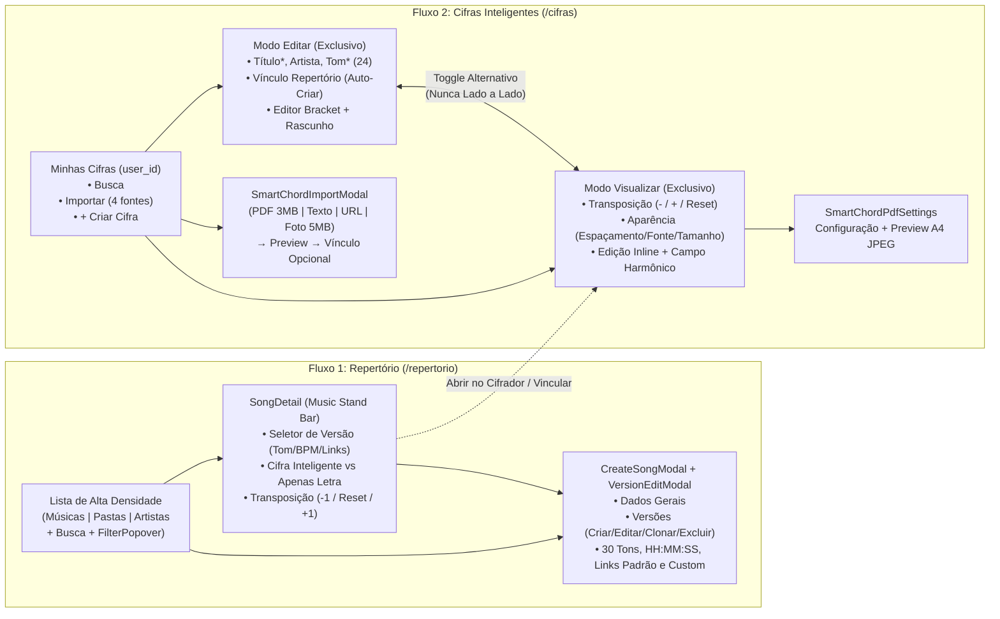

# LouvAIO — Pacote de Revisão Visual D1: Auditoria, Design System v1.0 e Protótipos

> [!IMPORTANT]
> **Status da Etapa D1:** Auditoria de código em modo **somente leitura** concluída sobre as bases certificadas (**Web/Backend R16 `29d09f1`**, **Android M20 `11b5797`** e **M21 Vocal `f3aed6cd`**). Nenhuma linha de código de produto foi alterada e o workspace WIP original permanece intacto.

---

## 1. Documentos e Protótipos Isolados Gerados no Workspace de Design

1. **[D1_Auditoria_Visual_e_Inventario.md](./D1_Auditoria_Visual_e_Inventario.md)**
   - Inventário completo das 25 rotas e seções da Web (`routing.ts`) e das 14 telas/fluxos do Flutter (`app_router.dart` e `app_shell.dart`).
   - Mapeamento de todos os componentes de `web/src/components/`, tokens CSS (`louvaio-brand.css`, `index.css`, `workspace.css`) e estilos inline.
   - Matriz de Preservação Funcional por tela (Versões musicais, Cifras Inteligentes, PDF A4, Escalas, Liturgias, Ministério/Assinatura e M21 Vocal).
   - Matriz de Paridade Web R16 vs. Flutter M20/M21 e Auditoria de Contraste WCAG 2.1 AA.
2. **[LouvAIO_Design_System_v1_0.md](./LouvAIO_Design_System_v1_0.md)**
   - Evolução do [LouvAIO_Design_System_v0_1.md](./LouvAIO_Design_System_v0_1.md) preservando a marca **LouvAIO** (sem `"2.0"`), Verde Profundo (`#0F2A1F`), Terracota (`#B85A3C`) e Creme (`#F5EFE6`).
   - Resolução da inversão entre `--brand-primary` e `--primary-brand` e correção das variáveis quebradas (`--bg-color`, `--bg-primary`, `--border`, `#7C3AED`).
   - Tokens Modo Claro e Modo Escuro com aprovação matemática no WCAG 2.1 AA.
3. **[D1_Especificacao_Repertorio_e_Cifras.md](./D1_Especificacao_Repertorio_e_Cifras.md)**
   - Especificação completa Desktop e Mobile dos fluxos de **Repertório** e **Cifras Inteligentes**, com tabela comparativa **Antes (R16) vs. Depois (D1)** justificando cada alteração.
4. **Protótipos Visuais Interativos (HTML/CSS Autônomos com Alternador Desktop/Mobile e Claro/Escuro):**
   - **[repertorio-desktop-mobile.html](./prototypes/repertorio-desktop-mobile.html)**: Lista de Repertório de alta densidade (`Músicas`, `Pastas`, `Artistas`, `FilterPopover`), Detalhe da Música (`Music Stand Bar`, seletor de versões, Cifra Inteligente vinculada, transposição, tablatura, progressão, ficha da versão e links) e Modal de Música/Versões (`Sticky Header/Footer`).
   - **[cifras-inteligentes-desktop-mobile.html](./prototypes/cifras-inteligentes-desktop-mobile.html)**: Biblioteca Pessoal (`Minhas Cifras`), Workspace com alternância estritamente exclusiva **`Editar` / `Visualizar`** (`data-workspace-mode="edit" | "read"`), Leitor com edição inline de acordes e sugestões do Campo Harmônico, Modal de Importação tokenizado (4 abas) e Preview PDF A4.

---

## 2. Arquitetura de Fluxo dos Protótipos D1

---

## 3. Principais Achados da Auditoria e Correções Propostas

| Problema Identificado no Código Real (R16) | Localização Real | Solução no Design System v1.0 e Protótipos D1 |
| :--- | :--- | :--- |
| **Inversão de `--brand-primary` vs `--primary-brand`** | `louvaio-brand.css` vs `index.css` | Unificado em tokens semânticos claros: `--brand-green` (`#0F2A1F`) para estrutura/identidade e `--action-primary-bg` (`#AE5235` / `#B85A3C`) para CTAs primários. |
| **Variáveis CSS inexistentes ou legadas** | `index.css` (`--bg-color`, `#7C3AED`), `SmartChordsWorkspace.tsx` (`--bg-primary`), `SmartChordReader.tsx` (`--border`) | Mapeadas e substituídas por `--bg-app`, `--bg-surface` e `--border-subtle` (com aliases retrocompatíveis documentados). |
| **Modal de Importação com cores azul-escuro hardcoded** | `SmartChordImportModal.tsx` (`#1e293b`, `#0f172a`, `#3b82f6`) | Totalmente redesenhado no protótipo usando os tokens oficiais Claro (`#F5EFE6`/`#FFFFFF`) e Escuro (`#0B1913`/`#11231B`). |
| **Contraste insuficiente em textos secundários e labels flutuantes** | `--text-muted: #7A8680` (3.22:1) e `FloatingSelect` `#86A38F` (2.61:1) | Corrigido para `--text-muted: #5C6862` (**4.95:1** ✅ AA) e rótulos superiores fixos em `--text-secondary: #46544E` (**6.8:1** ✅ AA). |
| **Baixa densidade de leitura no Repertório Desktop** | `SongCard.tsx` (cards de `90px+` em grade de 3 colunas) | Lista estruturada estilo Linear/Planning Center (`56px`/linha) exibindo 12–15 músicas por tela com `Versões`, `Tom`, `BPM/Duração`, `Classificações` e `Recursos`. |
| **Botões duplicados de PDF na toolbar do Cifrador** | `SmartChordToolbar.tsx` (`Exportar PDF` e `Configurações do PDF` chamam `handlePrint`) | Consolidado em ação clara `PDF / Imprimir` abrindo o painel integrado de Configuração + Preview A4. |
