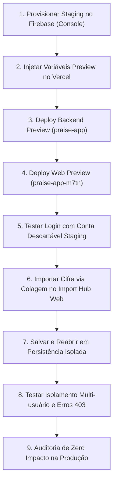

# M20-C9 — Preparação e Homologação de Staging

- Data: 2026-10-29
- Branch: `feat/m20-phase-2a-android-share`
- HEAD: `e3c4902e0d8786e164ea0686486c564f9dea1578` (WIP integralmente preservada)
- Papel: Orquestrador temporário (Gemini 4 Argon High) subordinado ao Codex

---

## 1. Status Geral do Gate de Homologação

**Status:** `READY_FOR_HOSTED_GATE`  
Todas as validações locais de isolamento, segurança de sessão, builds de produto e suítes de testes estão 100% aprovadas. O repositório encontra-se pronto para o procedimento de homologação hospedada, aguardando apenas autorização explícita e provisionamento de variáveis no provedor.

---

## 2. Auditoria dos Projetos Canônicos e Ambientes

### 2.1 Projetos Vercel Canônicos
- **Backend:** `praise-app`
  - Domínio canônico de produção: `https://praise-app-gray.vercel.app`
  - Padrão de Preview URLs: `https://praise-app-*-henriquecesarths-projects.vercel.app/api/v1`
  - Configuração: `backend/vercel.json` com runtime serverless em `src/app.ts` (maxDuration 60s).
- **Web:** `praise-app-m7tn`
  - Domínio canônico de produção: `https://praise-app-m7tn.vercel.app`
  - Padrão de Preview URLs: `https://praise-app-m7tn-*-henriquecesarths-projects.vercel.app`
  - Configuração: `web/vercel.json` com SPA rewrite para `/index.html`.
  - CORS backend: valida dinamicamente domínios autorizados e previews Vercel.

### 2.2 Isolamento Firebase
- **Produção:** `praise-app-7a362`
- **Preview / Staging:**
  - Código em `backend/src/config/unifiedConfig.ts` seleciona estritamente `FIREBASE_STAGING_*`:
    * `FIREBASE_STAGING_PROJECT_ID`
    * `FIREBASE_STAGING_CLIENT_EMAIL`
    * `FIREBASE_STAGING_PRIVATE_KEY`
    * `FIREBASE_STAGING_DATABASE_URL`
    * `FIREBASE_STAGING_WEB_API_KEY`
  - **Fail-Closed Ativo:** Se qualquer uma das credenciais estiver ausente ou se `FIREBASE_STAGING_PROJECT_ID === 'praise-app-7a362'`, o backend encerra imediatamente a inicialização com erro fatal.

### 2.3 Segurança de Autenticação e JWT
- Validação Zod em `unifiedConfig.ts`: em qualquer ambiente implantado (`isVercel || isPreview || production`), chaves ausentes, vazias ou padrão de desenvolvimento (`praise-app-jwt-secret-key-change-in-production`) são rejeitadas.
- Middleware de autenticação (`backend/src/middleware/auth.ts`): rejeita tokens forjados com segredo de desenvolvimento em Preview; valida ID tokens exclusivamente via Firebase Admin Staging.

### 2.4 Workflow Mobile Staging
- `.github/workflows/android-staging-apk.yml`:
  - Target: `lib/main.dart` com `--flavor staging` (`com.louvaio.app.staging`).
  - Permite instalação lado a lado com a versão de produção.
  - Valida que `FIREBASE_PROJECT_ID` difere de `praise-app-7a362`.
  - Valida que `STAGING_API_BASE_URL` é HTTPS Preview da Vercel (`/api/v1`).
  - Valida `google-services.json` contra as variáveis de ambiente.

### 2.5 Custos e Recursos Adicionais
- **Impacto Financeiro:** **ZERO (R$ 0,00)**.
- O plano Firebase Spark (gratuito) atende plenamente ao projeto de staging (Authentication e Firestore sob quotas gratuitas).
- Deploys de Preview estão inclusos no plano Vercel existente.
- Nenhuma infraestrutura paga ou dependência de proxy externo foi criada.

---

## 3. Verificação da Integração Local (Import Hub)

| Módulo | Escopo Validado | Testes Executados | Status |
|---|---|---|---|
| **Web Import Hub** | `SmartChordImportModal`: colagem texto/HTML, extração, preview alinhado, edição, retenção de rascunho em falha, isolamento de sessão | 48 testes unitários/componente | **PASS** |
| **Web Chords Utils** | Normalização de acordes, transposição, cifras inteligentes | 49 testes | **PASS** |
| **Backend Normalizer & Routes** | Parser de texto/cifra, normalizador musical, rotas de importação | 79 testes | **PASS** |
| **Backend Smart Chords Core** | Entidades, repositório, link ao repertório, IDOR, quotas | 273 testes | **PASS** |
| **Backend Preview Security** | Isolamento Preview/Production, matriz de ambiente Vercel, guarda JWT | 63 testes | **PASS** |
| **Mobile Auth & Providers** | Ciclo de vida de tokens, race conditions, isolamento de sessão UID/geração, resolução de dependência circular | 86 testes | **PASS** |
| **Mobile Smart Chords** | OCR de acordes, importação de cifras, persistência local, renderização | 310 testes | **PASS** |
| **Builds de Produto** | `tsc` backend e `tsc && vite build` web | 2 builds limpos | **PASS** |

Total: **908 testes automatizados aprovados**.

---

## 4. Roteiro Passo a Passo de Homologação Hospedada

### Detalhamento dos Passos:
1. **Provisionamento Firebase Staging:**
   - Criar projeto isolado (ex.: `praise-app-staging`).
   - Ativar Firebase Authentication (Email/Password) e Firestore Database.
   - Criar conta de teste descartável: `staging-tester@louvaio.test`.
   - Baixar credenciais da Service Account.
2. **Configuração Vercel Preview (Backend `praise-app`):**
   - Injetar no escopo *Preview-only*:
     `FIREBASE_STAGING_PROJECT_ID`, `FIREBASE_STAGING_CLIENT_EMAIL`, `FIREBASE_STAGING_PRIVATE_KEY`, `FIREBASE_STAGING_DATABASE_URL`, `FIREBASE_STAGING_WEB_API_KEY`, `JWT_SECRET`.
3. **Deploy Backend Preview:**
   - Deploy autorizado da branch `feat/m20-phase-2a-android-share`.
   - Verificar nos logs de boot: `isPreviewEnvironment() === true`, projeto staging carregado.
4. **Deploy Web Preview:**
   - Deploy do frontend com `VITE_API_URL` apontando para o Preview do Backend.
5. **Teste de Autenticação:**
   - Efetuar login com a conta descartável e verificar `GET /api/v1/auth/me`.
6. **Importação via Colagem:**
   - Colar texto de cifra no modal, validar alinhamento de harmonia e letra.
7. **Salvar e Reabrir:**
   - Confirmar persistência no Firestore Staging (`smart_chords`).
8. **Verificar Isolamento:**
   - Criar 2ª conta descartável; confirmar que não acessa a cifra da 1ª conta.
   - Confirmar bloqueio `403 PREVIEW_MODE_BLOCKED` em rotas de billing e jobs.
9. **Auditoria de Zero Impacto:**
   - Verificar console de produção `praise-app-7a362`: 0 dados criados ou modificados.

---

## 5. Autorizações Necessárias

Para prosseguir para o ambiente hospedado, o proprietário deve autorizar expressamente:
1. Criação do projeto Firebase Staging e conta de teste.
2. Configuração das variáveis Preview no painel Vercel.
3. Exceção temporária de proteção de deployment para o domínio Preview na Vercel (se SSO estiver ativo).
4. Disparo do deploy da branch `feat/m20-phase-2a-android-share`.
